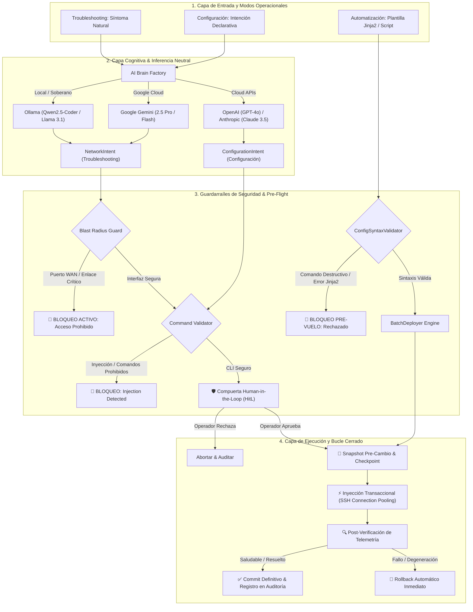

# 🌐 NetworkingAgent Enterprise v2.0

<div align="center">

[](https://www.python.org/)
[](https://textual.textualize.io/)
[]()
[](https://github.com/astral-sh/ruff)
[](LICENSE)
[]()
[]()

**Asistente Autónomo de Ingeniería de Redes en Bucle Cerrado (*Closed-Loop Automation*) con IA Multi-Cerebro**

```text
  _   _      _                      _     _               _                    _   
 | \ | | ___| |___      _____  _ __| | __(_)_ __   __ _  / \   __ _  ___ _ __ | |_ 
 |  \| |/ _ \ __\ \ /\ / / _ \| '__| |/ /| | '_ \ / _` |/ _ \ / _` |/ _ \ '_ \| __|
 | |\  |  __/ |_ \ V  V / (_) | |  |   < | | | | | (_| / ___ \ (_| |  __/ | | | |_ 
 |_| \_|\___|\__| \_/\_/ \___/|_|  |_|\_\|_|_| |_|\__, /_/   \_\__, |\___|_| |_|\__|
                                                   |___/        |___/                
                       Enterprise Autonomous Closed-Loop Network Agent                
```

*Diagnóstico de causa raíz autónomo (L1-L7), aprovisionamiento declarativo multi-protocolo en lenguaje natural, editor de plantillas Jinja2 con validación sintáctica pre-vuelo, despliegue masivo transaccional, blindaje de interfaces de gestión y rollback automático con Human-in-the-Loop.*

[📖 Guía de Uso](docs/USAGE_GUIDE.md) • [🏛️ Arquitectura](docs/ARCHITECTURE.md) • [🛡️ Seguridad](docs/SECURITY.md) • [🖧 Hardware Soportado](docs/SUPPORTED_HARDWARE.md)

</div>

---

## 🚀 Pilares Operacionales de la Versión 2.0

NetworkingAgent v2.0 estructura las operaciones de ingeniería de redes en **tres modos operacionales especializados**, gestionados a través de una consola de terminal reactiva (`Textual TUI`) de nivel empresarial:

### 1. 🔍 Modo Troubleshooting (Diagnóstico Autónomo en Lenguaje Natural)
- **Interrogación Autónoma Multi-Capa (L1-L7):** El operador describe el síntoma operacional en lenguaje natural (*"Vecindad OSPF en Gi0/1 estancada en EXSTART"* o *"Pérdida intermitente de paquetes en enlace de distribución"*).
- **Inspección Técnica en Vivo:** El asistente interroga de manera autónoma capas físicas, enlaces troncales, tablas de enrutamiento y logs (`show interfaces`, `show ip route`, `show ip bgp summary`, `show log`).
- **Dictamen Causa-Raíz y Blast Radius:** El cerebro de IA diagnostica el problema, verifica que no comprometa interfaces de gestión ni enlaces troncales críticos (*Blast Radius Guard*), y propone la remediación exacta antes de inyectar cualquier comando.

### 2. ⚙️ Modo Configuración (Aprovisionamiento Declarativo Multi-Vendor)
- **Generación Declarativa:** Solicitud de cambios de red en lenguaje natural (*"Configura BGP ASN 65100 con vecino 10.0.0.2 en AS 65200 anunciando la red 192.168.10.0/24"*).
- **Chips de Protocolo Especializados:** Selectores rápidos para **BGP**, **OSPF**, **EIGRP**, **STP**, **Port-Channel (LACP)**, **VLANs**, **ACLs** y **Servicios**.
- **Previsualización Diff & Human-in-the-Loop:** Síntesis multi-vendor (Cisco IOS/IOS-XE, Cisco NX-OS, Juniper Junos, MikroTik RouterOS) con tabla comparativa de cambios, cálculo automático de comandos de compensación reversa (*Rollback Plan*) y compuerta obligatoria de aprobación humana.

### 3. ⚡ Modo Automatización (Editor Jinja2 & Despliegue Masivo)
- **Editor de Plantillas Integrado:** Widget `TextArea` interactivo a pantalla completa con soporte de números de línea, navegación fluida y atajos.
- **Catálogo de Plantillas Incorporado:** Plantillas Jinja2 parametrizadas listas para producción (*Hardening Base Cisco*, *OSPF Multi-Area*, *Expansión de Troncales VLAN*, *BGP Peering*).
- **Validador Sintáctico Pre-Vuelo (`ConfigSyntaxValidator`):** Dry-run en tiempo real que intercepta comandos destructivos (`reload`, `write erase`, `format`, `/system reset-configuration`), verifica el balanceo de bloques jerárquicos (Junos `{ ... }`) y detecta variables Jinja2 no renderizadas (`{{ var }}`).
- **Despliegue Masivo Multi-Equipo:** Selección múltiple mediante lista interactiva (`SelectionList`), ejecución transaccional con snapshots de configuración previos por equipo y rollback individualizado ante anomalías.

---

## 🏛️ Diagrama de Arquitectura Closed-Loop v2.0



---

## 📁 Estructura del Repositorio

```
networkingAgent/
├── pyproject.toml              # Dependencias (Jinja2, Textual, Netmiko, Pydantic, etc.)
├── uv.lock                     # Lockfile determinista
├── README.md                   # Documentación principal
├── LICENSE                     # Licencia Apache 2.0
├── .env.example                # Plantilla de variables de entorno
├── main.py                     # Entrypoint TUI / CLI
├── data/                       # Almacenamiento local SQLite cifrado (0600)
├── backups/                    # Snapshots y configuraciones de respaldo
├── logs/                       # Bitácora inmutable de auditoría (audit.jsonl)
├── docs/                       # Documentación técnica completa
│   ├── USAGE_GUIDE.md          # Manual de operación detallado y ejemplos
│   ├── ARCHITECTURE.md         # Diseño hexagonal, componentes y diagramas
│   ├── SECURITY.md             # Modelo de amenazas, guardarraíles y hardening
│   └── SUPPORTED_HARDWARE.md   # Matriz de soporte de hardware y sintaxis CLI
├── src/
│   └── networking_agent/
│       ├── core/               # Criptografía, SQLite, config y auditoría
│       │   ├── crypto.py       # SecretVault cifrado con Fernet (AES-128-CBC)
│       │   ├── db.py           # DatabaseManager SQLite en modo WAL
│       │   ├── config.py       # Pydantic Settings
│       │   ├── logging.py      # Rich logging estructurado
│       │   ├── exceptions.py   # Excepciones de dominio y seguridad
│       │   └── audit.py        # Registro inmutable en audit.jsonl
│       ├── models/             # Modelos de datos validados con Pydantic
│       │   ├── intent.py       # NetworkIntent neutral para troubleshooting
│       │   ├── config_intent.py# ConfigurationIntent, plantillas y batch results
│       │   ├── device.py       # DeviceInventory con validación anti-traversal
│       │   └── telemetry.py    # TelemetryEvent saneado contra DoS
│       ├── guardrails/         # Capa de seguridad y contención de impacto
│       │   ├── blast_radius.py # Protección incondicional de WAN y gestión
│       │   ├── validator.py    # CommandValidator contra inyecciones y persistencia
│       │   └── syntax_validator.py # Pre-flight validator para scripts y Jinja2
│       ├── brains/             # Inferencia cognitivo-estructurada desacoplada
│       │   ├── base.py         # LLMBrain y prompts endurecidos del sistema
│       │   ├── ollama.py       # Inferencia local privada y soberana
│       │   ├── gemini.py       # Integración oficial Google GenAI
│       │   ├── openai.py       # Integración OpenAI GPT-4o
│       │   ├── anthropic.py    # Integración Anthropic Claude 3.5 Sonnet
│       │   └── factory.py      # Selector dinámico de proveedor con bóveda SQLite
│       ├── drivers/            # Drivers multi-vendor con pooling SSH
│       │   ├── base.py         # NetworkOSDriver, interrogación de protocolos y discovery
│       │   ├── cisco_ios.py    # Driver Cisco IOS / IOS-XE
│       │   ├── cisco_nxos.py   # Driver Cisco NX-OS (checkpoints nativos)
│       │   ├── cisco_xr.py     # Driver Cisco IOS-XR (commit confirmed)
│       │   ├── juniper.py      # Driver Juniper Junos (commit confirmed 3)
│       │   ├── mikrotik.py     # Driver MikroTik RouterOS v6/v7
│       │   └── factory.py      # Factoría de drivers
│       ├── engine/             # Orquestación del bucle cerrado y automatización
│       │   ├── agent.py        # NetworkAssistantAgent (Troubleshooting & Config)
│       │   ├── automation.py   # TemplateEngine (Jinja2) y BatchDeployer multi-host
│       │   ├── observer.py     # Protocolo de observabilidad desacoplado
│       │   └── verification.py # Motor de verificación pre vs post
│       ├── tui/                # Interfaz Gráfica de Terminal (Textual TUI)
│       │   ├── app.py          # Aplicación reactiva con 5 pilares operacionales
│       │   ├── styles.tcss     # Estilos enterprise oscuros (NOC Theme)
│       │   ├── widgets/        # Componentes visuales especializados
│       │   │   ├── banner_widget.py       # Banner ASCII con protección de ajuste
│       │   │   ├── home_view.py           # Dashboard de bienvenida y 5 cards
│       │   │   ├── troubleshooting_view.py# Workspace de diagnóstico interactivo
│       │   │   ├── configuration_view.py  # Workspace de aprovisionamiento declarativo
│       │   │   ├── automation_view.py     # Editor de plantillas, dry-run y batch
│       │   │   ├── device_sidebar.py      # Catálogo lateral con badges de OS
│       │   │   ├── device_inventory_view.py# Tabla completa de gestión de equipos
│       │   │   ├── audit_table.py         # Visor del historial JSONL de auditoría
│       │   │   └── status_bar.py          # Barra superior con telemetría en vivo
│       │   └── modals/         # Modales flotantes translúcidos
│       │       ├── hitl_modal.py          # Aprobación humana con diff visual
│       │       ├── device_modal.py        # Alta de equipo cifrada
│       │       └── vault_modal.py         # Ajustes de IA dinámicos por proveedor
│       └── cli/                # Modo consola clásico interactivo y por lotes
└── tests/                      # Suite de 125 pruebas automatizadas
    ├── test_brains.py
    ├── test_crypto.py
    ├── test_db.py
    ├── test_drivers.py
    ├── test_engine.py
    ├── test_evolution_v2.py    # Pruebas v2 (plantillas, batch, TUI 5 pilares)
    ├── test_guardrails.py
    ├── test_models.py
    ├── test_prompts.py
    └── test_tui.py
```

---

## ⚡ Guía de Inicio Rápido

### 1. Requisitos del Sistema
- Python `>= 3.12` (Certificado en Python `3.14`).
- [`uv`](https://github.com/astral-sh/uv) (Recomendado para gestión ultrarrápida de dependencias).

### 2. Instalación en 3 Pasos

```bash
# 1. Clonar el repositorio
git clone https://github.com/GuifMur98/networkingAgent.git
cd networkingAgent

# 2. Sincronizar el entorno virtual
uv sync --extra dev

# 3. Lanzar la aplicación
uv run python main.py
```

### 3. Navegación en la Interfaz Textual (TUI)

Al iniciar, se presenta el panel de control operacional con navegación por teclado y ratón:

| Atajo | Acción / Destino |
|:---:|---|
| `1` | Ir a **Troubleshooting** (Diagnóstico en lenguaje natural) |
| `2` | Ir a **Configuración** (Aprovisionamiento declarativo) |
| `3` | Ir a **Automatización** (Editor Jinja2 y despliegue masivo) |
| `4` | Ir a **Inventario de Equipos** (Alta, baja y prueba de conexión) |
| `5` | Ir a **Registro de Auditoría** (Historial JSONL inmutable) |
| `h` | **Volver al Inicio** desde cualquier vista |
| `s` | Abrir modal de **Ajustes de IA y Bóveda Criptográfica** |
| `d` | Abrir modal de **Registrar Nuevo Equipo** |
| `r` | **Recargar** inventario y bitácora de auditoría |
| `q` | **Salir** de la aplicación de forma segura |

---

## 🧪 Pruebas Automatizadas y Calidad

El proyecto cuenta con **125 pruebas automatizadas** con cobertura exhaustiva en:
- Validación de sintaxis CLI y detección de inyecciones maliciosas.
- Aislamiento y blindaje de interfaces WAN/gestión (*Blast Radius Guard*).
- Síntesis de configuración declarativa multi-vendor (Cisco, Juniper, MikroTik).
- Renderizado de plantillas Jinja2 y despliegue masivo por lotes con rollback.
- Navegación, modales y eventos reactivos en la TUI Textual.

```bash
# Ejecutar toda la suite de pruebas
uv run --no-sync pytest

# Validar formateo y linter estático (0 errores)
uv run --no-sync ruff check .
```

---

## 📚 Documentación Técnica

- **[📖 Manual de Uso y Operaciones (`docs/USAGE_GUIDE.md`)](docs/USAGE_GUIDE.md)**: Flujos paso a paso para Troubleshooting, Configuración y Automatización.
- **[🏛️ Arquitectura del Sistema (`docs/ARCHITECTURE.md`)](docs/ARCHITECTURE.md)**: Diseño hexagonal, diagramas de secuencia transaccionales y motores internos.
- **[🛡️ Manual de Ciberseguridad (`docs/SECURITY.md`)](docs/SECURITY.md)**: Modelo de amenazas, contención de radio de impacto y guardarraíles pre-vuelo.
- **[🖧 Matriz de Hardware Soportado (`docs/SUPPORTED_HARDWARE.md`)](docs/SUPPORTED_HARDWARE.md)**: Comandos de diagnóstico por protocolo, acciones soportadas y sintaxis por fabricante.

---

## 📄 Licencia

Este proyecto está licenciado bajo los términos de la licencia [Apache 2.0](LICENSE).
