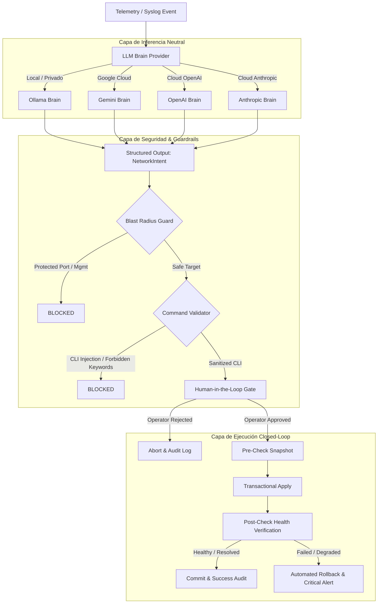

# NetworkingAgent Enterprise

[](https://www.python.org/)
[]()
[](https://github.com/astral-sh/ruff)
[]()

> **Enterprise Autonomous & Closed-Loop AI Network Engineering Assistant**  
> Translates untrusted network telemetry into vendor-neutral remediation intents, verifies security blast radius, performs real pre/post-change snapshots, and executes safe configuration changes with Human-in-the-Loop approval and automated rollback. Supports Cisco (IOS/NX-OS/XR), Juniper Junos, and MikroTik RouterOS.

---

## 🏛️ Architecture Overview

The system is designed with a **Defense-in-Depth** and **Decoupled Hexagonal Architecture**:



---

## 🛡️ Enterprise Security & Hardening Features

1. **Indirect Prompt Injection Defense:**
   - Raw telemetry is treated as untrusted data wrapped in `<telemetry_event>` XML delimiters.
   - Hardened system instructions strictly forbid the LLM from executing or following instructions embedded inside log payloads.
2. **Strict Regex & Type Validation:**
   - Interface names must match strict vendor regex patterns (`GigabitEthernet`, `Ethernet`, `ge-`, etc.).
   - Metacharacters, semicolons, shell pipes, and newline characters (`\n`, `\r`) are rejected at the Pydantic model level.
   - MTU values strictly enforced (`68` to `9216`).
   - BGP IPs strictly parsed through standard `ipaddress.ip_address`.
3. **Blast Radius & Blacklisted Resources:**
   - Prevents autonomous modification or shutdown of out-of-band management interfaces (`Management0`, `mgmt0`, `GigabitEthernet0/0`) or core loopbacks.
4. **Credential Protection:**
   - Zero hardcoded plaintext credentials.
   - `DeviceInventory` encapsulates secrets inside Pydantic's `SecretStr` (redacted in `__repr__` and logging).
5. **Real Snapshots & Automated Rollback:**
   - Real hardware checkpoint (`checkpoint` in NX-OS) and running-config snapshot downloaded before writing changes.
   - Supports `commit confirmed` (Junos / IOS-XR) and automated rollback if post-change verification fails.
6. **Immutable Audit Trail:**
   - Every proposal, operator approval, injected CLI command, and execution result is written to a structured JSONL audit trail (`logs/audit.jsonl`).

---

## 📁 Project Structure

```
networkingAgent/
├── pyproject.toml              # Dependencies, build metadata, ruff & pytest configs
├── uv.lock                     # Deterministic dependency lockfile
├── README.md                   # Project documentation
├── .env.example                # Environment variables template
├── main.py                     # Entrypoint script
├── src/
│   └── networking_agent/
│       ├── core/               # Settings, logging, custom exceptions, audit trail
│       │   ├── config.py
│       │   ├── logging.py
│       │   ├── exceptions.py
│       │   └── audit.py
│       ├── models/             # Strict Pydantic models
│       │   ├── intent.py       # Neutral NetworkIntent schema
│       │   ├── device.py       # DeviceInventory
│       │   └── telemetry.py    # TelemetryEvent
│       ├── guardrails/         # Security validation
│       │   ├── validator.py    # Command injection prevention
│       │   └── blast_radius.py # Blast radius policies
│       ├── brains/             # AI provider abstractions
│       │   ├── base.py
│       │   ├── ollama.py
│       │   ├── openai.py
│       │   ├── anthropic.py
│       │   └── factory.py
│       ├── drivers/            # Multi-vendor OS automation
│       │   ├── base.py
│       │   ├── cisco_ios.py
│       │   ├── cisco_nxos.py
│       │   ├── cisco_xr.py
│       │   ├── juniper.py
│       │   └── factory.py
│       ├── engine/             # Closed-Loop orchestrator
│       │   ├── agent.py
│       │   └── verification.py
│       └── cli/                # Command line interface
│           └── main.py
└── tests/                      # Comprehensive test suite (35+ unit tests)
    ├── conftest.py
    ├── test_models.py
    ├── test_guardrails.py
    ├── test_drivers.py
    └── test_engine.py
```

---

## 🚀 Quick Start

### 1. Installation

This project uses [`uv`](https://github.com/astral-sh/uv) for fast and deterministic package management:

```bash
# Clone the repository
git clone <repo-url>
cd networkingAgent

# Synchronize virtual environment with all dev dependencies
uv sync --extra dev
```

### 2. Configuration

Copy the environment template and set your credentials:

```bash
cp .env.example .env
```

Edit `.env` to configure:
- `AI_PROVIDER` (`ollama`, `openai`, or `anthropic`)
- `OPENAI_API_KEY` / `ANTHROPIC_API_KEY` (if using cloud providers)
- `NET_USER` / `NET_PASS` (for network devices)

### 3. Execution

#### Direct script execution:
```bash
uv run python main.py
```

#### CLI tool execution:
```bash
uv run networking-agent --provider ollama --model llama3.1 --device-host 10.10.20.11 --device-type cisco_nxos
```

---

## 🧪 Testing and Quality Assurance

Run the complete test suite:

```bash
uv run --no-sync pytest
```

Run linting and static checks:

```bash
uv run --no-sync ruff check .
```

Format code:

```bash
uv run --no-sync ruff format .
```

---

## 📄 License
Internal Enterprise Network Engineering Automation - Apache 2.0 / Proprietary.
