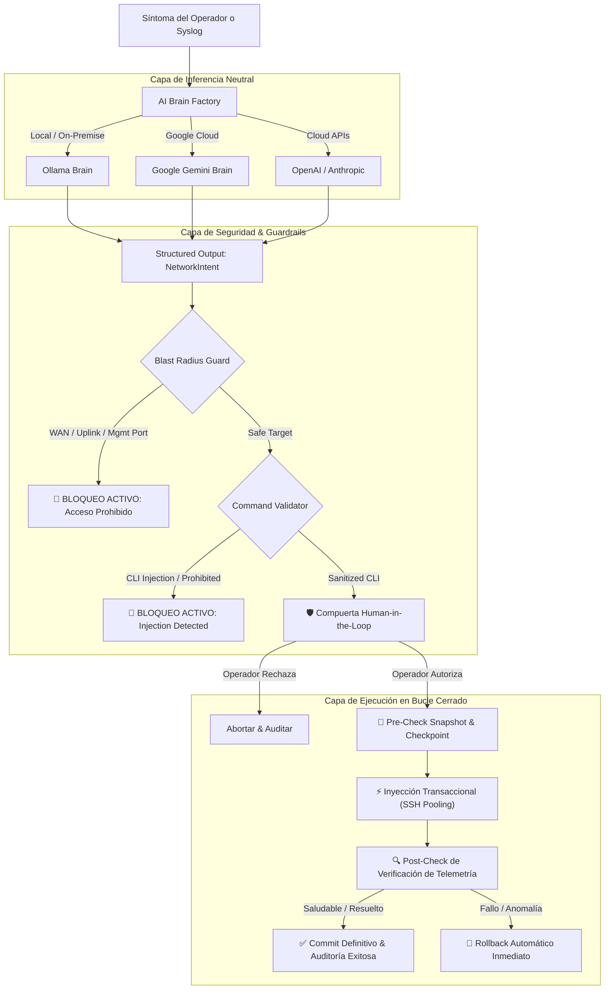

# 🌐 NetworkingAgent Enterprise

<div align="center">

[](https://www.python.org/)
[](https://textual.textualize.io/)
[]()
[](https://github.com/astral-sh/ruff)
[](LICENSE)
[]()
[]()

**Asistente Autónomo de Ingeniería de Redes en Bucle Cerrado (*Closed-Loop Automation*) con IA Multi-Cerebro**

*Traduce telemetría no confiable y síntomas operativos en intenciones neutrales, verifica radio de impacto (Blast Radius), descubre dinámicamente interfaces de gestión para evitar pérdida de acceso, realiza snapshots de configuración reales y ejecuta cambios transaccionales con aprobación humana (HitL) y rollback automático.*

[📖 Guía de Uso](docs/USAGE_GUIDE.md) • [🏛️ Arquitectura](docs/ARCHITECTURE.md) • [🛡️ Seguridad](docs/SECURITY.md) • [🖧 Hardware Soportado](docs/SUPPORTED_HARDWARE.md)

</div>

---

## 🚀 Capacidades Principales

- **🧠 Multi-Cerebro de IA Desacoplado:** Inferencia local y privada sin fuga de datos mediante **Ollama** (`netexpert:latest`, `llama3.1`) o modelos frontera en la nube con **Google Gemini** (`gemini-2.5-pro` / `gemini-2.5-flash`), **OpenAI** y **Anthropic**.
- **🔌 Soporte Multi-Fabricante de Producción:** Drivers nativos para **Cisco IOS/IOS-XE**, **Cisco NX-OS** (sesiones atómicas y checkpoints), **Cisco IOS-XR** (`commit confirmed`), **Juniper Junos** (`commit confirmed 3`), y **MikroTik RouterOS** (v6 y v7 con `/system backup`).
- **🔍 Diagnóstico Proactivo & Reactivo:**
  - **Proactivo:** El operador reporta síntomas en lenguaje natural (*"siento lento el internet"*, *"pérdidas en ether2"*); el agente interroga en vivo el router, analiza uso de CPU, descartes de paquetes y enlace físico, determinando con precisión técnica si se requiere o no modificación.
  - **Reactivo:** Ingesta y análisis automático de syslogs o eventos de monitorización.
- **🛡️ Blindaje de Gestión y Blast Radius:** Descubrimiento dinámico de la interfaz que sostiene la sesión SSH o la ruta por defecto (`discover_active_management_interfaces`), bloqueando de forma incondicional cualquier intento de apagar o reiniciar interfaces WAN/uplinks.
- **⚡ Optimización de Rendimiento (SSH Pooling):** Mantiene y reutiliza una única sesión SSH activa a lo largo del diagnóstico, pre-check, inyección y post-verificación, reduciendo tiempos de respuesta de 15 segundos a menos de 2 segundos.
- **🔒 Bóveda Criptográfica en SQLite:** Claves de API y contraseñas de red cifradas simétricamente con Fernet (AES-128-CBC) en `data/networking_agent.db`, blindada con permisos `0600`.
- **🛑 Human-in-the-Loop con Repregunta Continua:** Previsualización exacta de comandos CLI a inyectar con diff visual. Si el operador comete un error tipográfico, el sistema no cancela abruptamente ni ejecuta accidentalmente.
- **🔄 Rollback Automático y Snapshots Reales:** Si la post-verificación detecta que el problema no se resolvió o se degradó el servicio, se activa de inmediato el rollback hacia el snapshot previo.
- **📜 Auditoría Inmutable:** Registro estructurado en formato JSONL (`logs/audit.jsonl`).

---

## 🏛️ Diagrama de Arquitectura y Flujo Closed-Loop



---

## 📁 Estructura del Proyecto

```
networkingAgent/
├── pyproject.toml              # Metadatos, dependencias, ruff y pytest
├── uv.lock                     # Lockfile determinista de dependencias
├── README.md                   # Documentación principal
├── LICENSE                     # Licencia Apache 2.0
├── .env.example                # Plantilla de variables de entorno
├── main.py                     # Entrypoint interactivo y CLI
├── data/                       # Almacenamiento local SQLite cifrado (0600)
├── backups/                    # Snapshots y configuraciones de respaldo
├── logs/                       # Trazas de ejecución y auditoría (audit.jsonl)
├── docs/                       # Documentación técnica profunda
│   ├── USAGE_GUIDE.md          # Manual completo de uso y casos de prueba
│   ├── ARCHITECTURE.md         # Diseño hexagonal, componentes y diagramas
│   ├── SECURITY.md             # Modelo de amenazas y hardening anti-hacking
│   └── SUPPORTED_HARDWARE.md   # Matriz de compatibilidad y comandos multi-vendor
├── src/
│   └── networking_agent/
│       ├── core/               # Bóveda criptográfica, base de datos, config, auditoría
│       │   ├── crypto.py       # SecretVault con cifrado Fernet (AES-128)
│       │   ├── db.py           # DatabaseManager SQLite en modo WAL
│       │   ├── config.py       # Pydantic Settings
│       │   ├── logging.py      # Rich logging estructurado
│       │   ├── exceptions.py   # Excepciones de dominio y seguridad
│       │   └── audit.py        # Registro inmutable en audit.jsonl
│       ├── models/             # Esquemas estrictos de Pydantic
│       │   ├── intent.py       # NetworkIntent neutral con regex multi-vendor
│       │   ├── device.py       # DeviceInventory con validación de host anti-traversal
│       │   └── telemetry.py    # TelemetryEvent saneado con límite de DoS
│       ├── guardrails/         # Capa de seguridad y blast radius
│       │   ├── blast_radius.py # Protección incondicional de WAN y gestión
│       │   └── validator.py    # CommandValidator contra inyecciones y persistencia
│       ├── brains/             # Proveedores de inferencia neutral
│       │   ├── base.py         # Abstracción y HARDENED_SYSTEM_PROMPT
│       │   ├── ollama.py       # Inferencia local privada
│       │   ├── gemini.py       # Integración oficial Google GenAI
│       │   ├── openai.py       # Integración OpenAI GPT-4o
│       │   ├── anthropic.py    # Integración Anthropic Claude 3.5 Sonnet
│       │   └── factory.py      # Selector dinámico de proveedor
│       ├── drivers/            # Automatización multi-vendor con SSH pooling
│       │   ├── base.py         # NetworkOSDriver (agrupación SSH y dynamic discovery)
│       │   ├── cisco_ios.py    # Driver Cisco IOS / IOS-XE
│       │   ├── cisco_nxos.py   # Driver Cisco NX-OS (checkpoints nativos)
│       │   ├── cisco_xr.py     # Driver Cisco IOS-XR (commit confirmed)
│       │   ├── juniper.py      # Driver Juniper Junos (commit confirmed 3)
│       │   ├── mikrotik.py     # Driver MikroTik RouterOS v6/v7
│       │   └── factory.py      # Factory de drivers
│       ├── engine/             # Orquestador del bucle cerrado
│       │   ├── agent.py        # NetworkAssistantAgent
│       │   ├── observer.py     # Protocolo de observabilidad desacoplado
│       │   └── verification.py # VerificationEngine (pre vs post)
│       ├── tui/                # Interfaz Gráfica de Terminal (Textual TUI)
│       │   ├── app.py          # Aplicación reactiva multihilo
│       │   ├── styles.tcss     # Estilos modernos Cyberpunk/Nord
│       │   ├── widgets/        # Banner ASCII, dashboard de inicio, workspace, inventario y auditoría
│       │   └── modals/         # Modales de aprobación HitL, equipos y bóveda de IA
│       └── cli/                # Interfaz clásica por consola
│           ├── main.py         # Controlador de flujo y continuidad
│           ├── interactive.py  # Menús ricos, banner ASCII y autodescubrimiento
│           └── prompts.py      # Validadores interactivos de repregunta
└── tests/                      # Suite de 114 pruebas unitarias automatizadas
    ├── test_brains.py
    ├── test_crypto.py
    ├── test_db.py
    ├── test_drivers.py
    ├── test_engine.py
    ├── test_guardrails.py
    ├── test_models.py
    ├── test_prompts.py
    └── test_tui.py
```

---

## ⚡ Guía de Inicio Rápido

### 1. Requisitos Previos

- Python `>= 3.12` (Probado en Python 3.14).
- [`uv`](https://github.com/astral-sh/uv) instalado.

### 2. Instalación

```bash
# Clonar el proyecto
git clone <url-del-repositorio>
cd networkingAgent

# Sincronizar dependencias
uv sync --extra dev
```

### 3. Configuración

Copia la plantilla de variables:

```bash
cp .env.example .env
```

*(Opcional: Si deseas utilizar Google Gemini, configura `GEMINI_API_KEY=tu_clave` o agrégala desde el menú interactivo).*

### 4. Modos de Ejecución

#### 🚀 Modo A: Interfaz Gráfica de Terminal Reactiva (Textual TUI - Predeterminado)
Inicia la experiencia interactiva moderna con navegación visual por pestañas, catálogo lateral de equipos, historial de auditoría y diálogos modales de autorización HitL:

```bash
# Iniciar TUI moderna (por defecto en terminales interactivos)
uv run python main.py

# O explícitamente con la bandera:
uv run networking-agent --tui
```

*Atajos de teclado en la TUI:*
- `q`: Salir de la aplicación.
- `d`: Registrar nuevo equipo de red (Abre modal cifrado).
- `s`: Ajustes del Cerebro de IA y Bóveda criptográfica.
- `r`: Recargar inventario y tabla de auditoría.
- `y` / `n`: Autorizar o Rechazar cambios en el diálogo HitL.

#### 📟 Modo B: Asistente Interactivo de Consola Clásico (Rich Wizard)
Si prefieres el menú paso a paso secuencial en la consola:

```bash
uv run networking-agent --cli
# o versión corta:
uv run python main.py -c
```

#### 🤖 Modo C: Ejecución Automatizada / CI/CD (Sin Intervención)
Para pipelines de monitoreo o ejecución por lotes:

```bash
uv run networking-agent \
  --provider ollama \
  --model netexpert:latest \
  --device-host 192.168.1.1 \
  --device-type cisco_ios \
  --mode PROACTIVE \
  --log-message "Pérdida de paquetes en GigabitEthernet0/1"
```

---

## 🖥️ Demostración del Flujo Interactivo

Al iniciar, se presenta el panel de control:

```
  _   _      _                      _     _               _                    _   
 | \ | | ___| |___      _____  _ __| | __(_)_ __   __ _  / \   __ _  ___ _ __ | |_ 
 |  \| |/ _ \ __\ \ /\ / / _ \| '__| |/ /| | '_ \ / _` |/ _ \ / _` |/ _ \ '_ \| __|
 | |\  |  __/ |_ \ V  V / (_) | |  |   < | | | | | (_| / ___ \ (_| |  __/ | | | |_ 
 |_| \_|\___|\__| \_/\_/ \___/|_|  |_|\_\|_|_| |_|\__, /_/   \_\__, |\___|_| |_|\__|
                                                   |___/        |___/                
                       Enterprise Autonomous Closed-Loop Network Agent                
```

### Opciones del Menú Principal:
- **`[1] 🚀 Iniciar Diagnóstico y Remediación Asistida`**: Selección de equipo, modo proactivo (síntomas) o reactivo (telemetría), análisis de IA y autorización humana HitL.
- **`[2] 🖥️ Gestionar Inventario de Dispositivos`**: Registro, prueba de conectividad SSH y eliminación de routers Cisco, Juniper y MikroTik con credenciales cifradas.
- **`[3] 🧠 Configurar Proveedor de IA y Bóveda Criptográfica`**: Configuración de proveedores (Ollama, Gemini, OpenAI, Claude), modelos y llaves criptográficas.
- **`[4] 📋 Historial de Auditoría Criptográfica (audit.jsonl)`**: Visualización formateada de registros de auditoría inmutables.
- **`[5] 🚪 Salir del Sistema`**.
- *(En cualquier submenú, ingrese `[0]` para cancelar y regresar al Menú Principal sin reiniciar)*.

En el modo TUI (`--tui`), dispone de la pestaña inicial **`[Inicio]`** con accesos directos, botones explícitos `[⬅️ Volver al Menú Principal]` en cada vista y la tecla rápida `h` para retornar al inicio en cualquier momento.

---

## 🧪 Pruebas Automatizadas y Calidad de Código

El repositorio cuenta con **114 pruebas unitarias** pasando al 100%, validando modelos, validadores de inyección, blindaje WAN, criptografía, base de datos SQLite, interfaces TUI, navegación y pooling SSH:

```bash
# Ejecutar todas las pruebas unitarias
uv run --no-sync pytest

# Ejecutar el linter estático (0 advertencias)
uv run --no-sync ruff check .

# Formatear el código
uv run --no-sync ruff format .
```

---

## 📚 Documentación Técnica Detallada

Para guías específicas, consulta la carpeta [`docs/`](docs/):

1. **[Guía de Uso y Operaciones (`docs/USAGE_GUIDE.md`)](docs/USAGE_GUIDE.md)**: Manual paso a paso, configuración de equipos, resolución de problemas y preguntas frecuentes.
2. **[Arquitectura y Diseño (`docs/ARCHITECTURE.md`)](docs/ARCHITECTURE.md)**: Patrones de diseño hexagonal, diagramas de secuencia e interacciones internas.
3. **[Manual de Ciberseguridad (`docs/SECURITY.md`)](docs/SECURITY.md)**: Modelo de amenazas, análisis de vectores de inyección y defensas implementadas.
4. **[Matriz de Hardware Soportado (`docs/SUPPORTED_HARDWARE.md`)](docs/SUPPORTED_HARDWARE.md)**: Lista detallada de equipos certificados (Cisco, Juniper, MikroTik), comandos de diagnóstico y sintaxis CLI.

---

## 📄 Licencia

Este proyecto está distribuido bajo los términos de la licencia [Apache 2.0](LICENSE).
