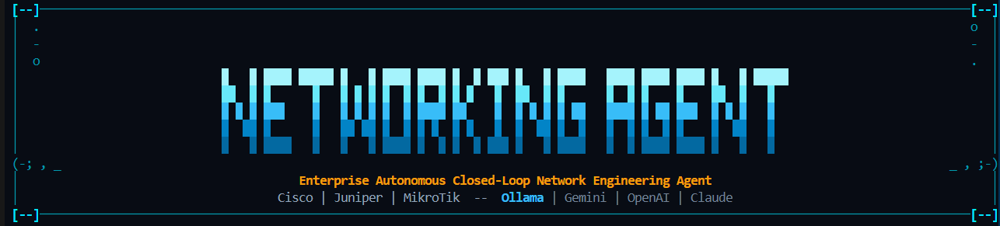
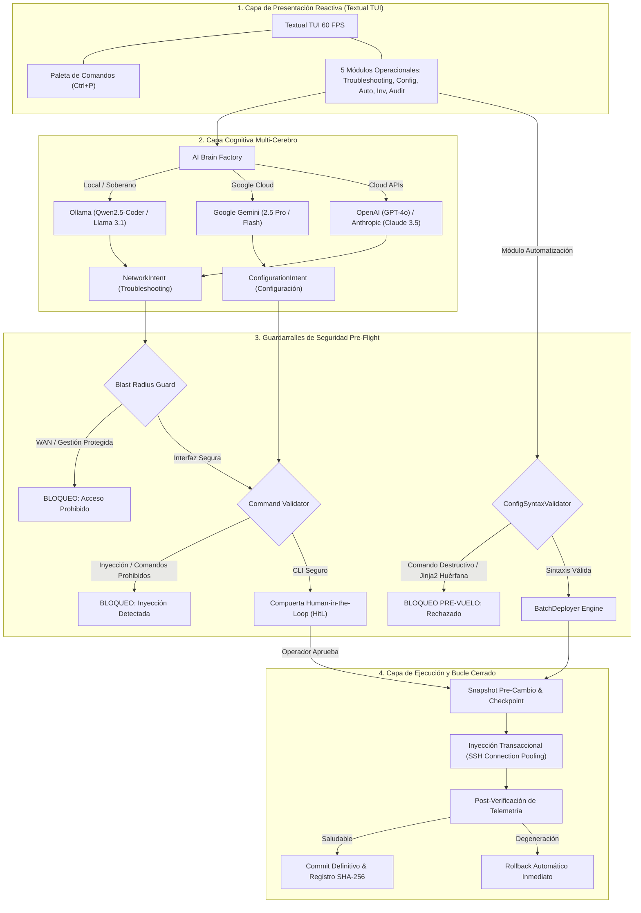

# 🌐 NetworkingAgent Enterprise v2.1.1

<div align="center">

[](https://www.python.org/)
[](https://textual.textualize.io/)
[]()
[](https://github.com/astral-sh/ruff)
[](LICENSE)
[]()
[]()

**Asistente Autónomo de Ingeniería de Redes en Bucle Cerrado (*Closed-Loop Automation*) con IA Multi-Cerebro**



*Diagnóstico de causa raíz autónomo (L1-L7), aprovisionamiento declarativo multi-protocolo, editor de plantillas Jinja2 con guía interactiva de variables dinámicas, validación sintáctica pre-vuelo, pruebas de conectividad en tiempo real (Ping ICMP y Socket SSH), paleta de comandos con temas ergonómicos (agent-light / agent-dark), sandbox Jinja2 anti-SSTI, transporte SSH inmune a MitM y bitácora forense inmutable con encadenamiento continuo SHA-256.*

[📖 Guía de Uso](docs/USAGE_GUIDE.md) • [🏛️ Arquitectura](docs/ARCHITECTURE.md) • [🛡️ Seguridad](docs/SECURITY.md) • [🖧 Hardware Soportado](docs/SUPPORTED_HARDWARE.md)

</div>

---

## 🚀 Pilares Operacionales de la Versión 2.1.1

NetworkingAgent Enterprise estructura las operaciones de ingeniería de redes en **cinco módulos especializados**, coordinados desde una consola de terminal reactiva (`Textual TUI`) con estética *Cyberpunk NOC Mission Control*:

### 1. 🔍 Modo Troubleshooting (Diagnóstico Autónomo en Lenguaje Natural)
- **Interrogación Autónoma Multi-Capa (L1-L7):** El operador describe el síntoma operacional (*"Vecindad OSPF en Gi0/1 estancada en EXSTART"* o *"Pérdida intermitente de paquetes en troncal"*).
- **Inspección Técnica en Vivo:** El asistente ejecuta interrogaciones en caliente según el fabricante y protocolo (`show interfaces`, `show ip route`, `show ip bgp summary`, `show log`, `/ip route print`).
- **Dictamen Causa-Raíz y Blast Radius:** El motor de IA analiza la telemetría, comprueba que ninguna interfaz crítica o de gestión esté en riesgo (*Blast Radius Guard*) y elabora la remediación precisa antes de solicitar autorización.

### 2. ⚙️ Modo Configuración (Aprovisionamiento Declarativo Multi-Vendor)
- **Generación Declarativa:** Solicitud de cambios de red en lenguaje natural (*"Configura BGP ASN 65100 con vecino 10.0.0.2 en AS 65200 anunciando la red 192.168.10.0/24"*).
- **Chips de Protocolo Especializados:** Selectores rápidos para **BGP**, **OSPF**, **EIGRP**, **Enrutamiento Dinámico**, **VLAN & Trunk**, **Port-Channel (LACP)**, **Seguridad / ACL** y **Servicios (NTP/Syslog)**.
- **Previsualización Diff & Human-in-the-Loop:** Síntesis multi-vendor (Cisco IOS/IOS-XE, Cisco NX-OS, Cisco IOS-XR, Juniper Junos, MikroTik RouterOS) con cálculo de comandos de reversión (*Rollback Plan*) y compuerta obligatoria de aprobación humana.

### 3. ⚡ Modo Automatización (Editor Jinja2, Guía de Variables & Despliegue Masivo)
- **Editor de Plantillas Integrado:** Widget `TextArea` interactivo a pantalla completa con soporte de numeración de líneas y edición fluida.
- **Guía de Variables Dinámicas Jinja2:** Panel visual integrado con sintaxis `{{ nombre_variable }}` y chips de inserción rápida de parámetros comunes (`vlan_id`, `vlan_name`, `ip_address`, `netmask`, `gateway`, `interface`, `description`, `bgp_as`).
- **Detección Automática de Variables:** Botón de escaneo que identifica y resalta las variables declaradas dentro del script.
- **Validador Sintáctico Pre-Vuelo (`ConfigSyntaxValidator`):** Análisis en seco (*dry-run*) que intercepta comandos destructivos (`reload`, `write erase`, `format`, `/system reset-configuration`), valida paridad de llaves en Junos (`{ ... }`), comprueba formatos de máscara y previene variables huérfanas sin procesar.
- **Despliegue Masivo Multi-Equipo:** Selección múltiple mediante lista interactiva (`SelectionList`), ejecución transaccional con snapshots de configuración previos por equipo y rollback individualizado ante anomalías.

### 4. 🖧 Modo Inventario y Pruebas de Conectividad en Tiempo Real
- **Catálogo de Dispositivos:** Gestión cifrada de routers, switches y firewalls en SQLite WAL con claves protegidas por AES-128-CBC (Fernet).
- **Prueba de Ping ICMP:** Medición de alcance IP y latencia de ida y vuelta en tiempo real sin salir de la TUI.
- **Prueba de Servicio SSH (TCP 22):** Comprobación no invasiva de socket de red para verificar la disponibilidad del demonio SSH antes de intentar operaciones de configuración.
- **Diagnóstico Integral:** Ejecución combinada de Ping y SSH con retroalimentación inmediata sobre la tabla de inventario.

### 5. 🛡️ Modo Auditoría y Trazabilidad Forense
- **Bitácora Inmutable SHA-256:** Registro forense criptográfico de cada acción, síntesis CLI, comandos inyectados, respuesta del router y snapshots de reversión.
- **Filtros Dinámicos:** Segmentación de registros por dispositivo objetivo y por estado operativo (`ALL`, `SUCCESS`, `FAILED`, `ROLLBACK`, `BLOCKED`).
- **Exportación JSON:** Descarga de registros estructurados para integración con plataformas SIEM o auditorías corporativas.
- **Purga Controlada de Pruebas:** Funcionalidad para depurar eventos transitorios o pruebas sintéticas preservando la integridad de la bitácora operativa.

---

## ⌨️ Paleta de Comandos Profesional (`Ctrl+P`)

La plataforma incorpora una **Paleta de Comandos** global accesible desde cualquier pantalla con `Ctrl+P` (y con indicador anclado en la esquina inferior derecha del Dashboard de Inicio):

- **Diseño Sobrio Enterprise NOC:** Cero emojis e iconos decorativos, priorizando etiquetas técnicas de alta densidad.
- **Búsqueda Difusa (Fuzzy Search):** Localización inmediata de operaciones tecleando palabras clave.
- **Catálogo Exhaustivo de Operaciones del Sistema:**
  - **Temas Visuales Ergonómicos de Primera Clase:**
    - **`agent-light` (Modo Claro Suave):** Paleta ergonómica en tonos zinc/slate (`#f8fafc` fondo, `#ffffff` superficie, `#1e293b` texto oscuro, `#cbd5e1` / `#0369a1` bordes sutiles, acentos esmeralda y ámbar cálido), optimizada para eliminar fatiga visual y reflejos.
    - **`agent-dark` (Modo Oscuro Cyberpunk):** Estética NOC de misión crítica (`#0a0f1d` fondo profundo, `#111827` superficie, acentos cian `#00e5ff` y oro `#fbbf24`).
    - **Selector de +20 Temas de Textual:** Nord, Dracula, Tokyo Night, Gruvbox, etc. con persistencia automática en base de datos SQLite (`app_theme`) y conmutador rápido claro/oscuro.
  - **Navegación Global:** Desplazamiento instantáneo al Dashboard Principal o a los 5 módulos operacionales (`1` al `5`).
  - **Seguridad y Configuración:** Configuración de IA y bóveda criptográfica, alternancia de guardarraíles (HITL) y registro de equipos.
  - **Utilidades de Terminal:** Captura vectorial de pantalla en formato SVG (`logs/screenshot_*.svg`), limpieza de consola activa y recarga/sincronización global del sistema (`F5` / `r`).

---

## 🏛️ Diagrama de Arquitectura Closed-Loop v2.1



---

## 📁 Estructura del Repositorio

```
networkingAgent/
├── pyproject.toml              # Metadatos del proyecto y dependencias (v2.1.1)
├── uv.lock                     # Lockfile determinista
├── install.ps1                 # Instalador One-Click automatizado para Windows (PowerShell)
├── install.sh                  # Instalador One-Click automatizado para Linux / macOS (Bash)
├── networking_agent.spec       # Especificación PyInstaller para binario independiente
├── README.md                   # Documentación principal del proyecto
├── CHANGELOG.md                # Bitácora detallada de cambios y versiones (v2.1.1)
├── CONTRIBUTING.md             # Guía de contribución y estándares de código
├── LICENSE                     # Licencia Apache 2.0
├── .env.example                # Plantilla de variables de entorno
├── main.py                     # Entrypoint TUI / CLI reactivo
├── scripts/                    # Scripts de empaquetado y utilidades
│   └── build_standalone.py     # Compilador standalone y generador de release .zip/.tar.gz
├── data/                       # Almacenamiento local SQLite cifrado (WAL mode)
├── backups/                    # Snapshots y configuraciones de respaldo por equipo
├── logs/                       # Bitácora inmutable de auditoría (audit.jsonl)
├── docs/                       # Documentación técnica completa
│   ├── banner.png              # Gráfico del encabezado de documentación
│   ├── INSTALLATION_GUIDE.md   # Guía definitiva de instalación y despliegue
│   ├── USAGE_GUIDE.md          # Manual de operación detallado y flujos paso a paso
│   ├── ARCHITECTURE.md         # Diseño hexagonal, componentes y diagramas
│   ├── SECURITY.md             # Modelo de amenazas, guardarraíles y hardening
│   └── SUPPORTED_HARDWARE.md   # Matriz de hardware, sintaxis CLI y comandos
├── src/
│   └── networking_agent/
│       ├── core/               # Criptografía, SQLite, config y auditoría
│       │   ├── crypto.py       # SecretVault cifrado con Fernet (AES-128-CBC)
│       │   ├── db.py           # DatabaseManager SQLite en modo WAL
│       │   ├── config.py       # Pydantic Settings
│       │   ├── logging.py      # Rich logging estructurado
│       │   ├── exceptions.py   # Excepciones de dominio y seguridad
│       │   └── audit.py        # Registro forense inmutable con SHA-256
│       ├── models/             # Modelos de datos validados con Pydantic
│       │   ├── intent.py       # NetworkIntent neutral para troubleshooting
│       │   ├── config_intent.py# ConfigurationIntent, plantillas y batch results
│       │   ├── device.py       # DeviceInventory con validación anti-traversal
│       │   └── telemetry.py    # TelemetryEvent saneado contra DoS
│       ├── guardrails/         # Capa de seguridad y contención de impacto
│       │   ├── blast_radius.py # Protección incondicional de WAN y gestión
│       │   ├── validator.py    # CommandValidator contra inyecciones y persistencia
│       │   └── syntax_validator.py # Pre-flight validator para scripts y Jinja2
│       ├── brains/             # Inferencia cognitivo-estructurada desacoplada
│       │   ├── base.py         # LLMBrain y prompts endurecidos del sistema
│       │   ├── discovery.py    # Autodescubrimiento de modelos locales de Ollama
│       │   ├── ollama.py       # Inferencia local privada y soberana
│       │   ├── gemini.py       # Integración oficial Google GenAI
│       │   ├── openai.py       # Integración OpenAI GPT-4o
│       │   ├── anthropic.py    # Integración Anthropic Claude 3.5 Sonnet
│       │   └── factory.py      # Selector dinámico de proveedor con bóveda SQLite
│       ├── drivers/            # Drivers multi-vendor con pooling SSH
│       │   ├── base.py         # NetworkOSDriver, interrogación de protocolos y discovery
│       │   ├── cisco_ios.py    # Driver Cisco IOS / IOS-XE
│       │   ├── cisco_nxos.py   # Driver Cisco NX-OS (checkpoints nativos)
│       │   ├── cisco_xr.py     # Driver Cisco IOS-XR (commit confirmed)
│       │   ├── juniper.py      # Driver Juniper Junos (commit confirmed 3)
│       │   ├── mikrotik.py     # Driver MikroTik RouterOS v6/v7
│       │   └── factory.py      # Factoría de drivers
│       ├── engine/             # Orquestación del bucle cerrado y automatización
│       │   ├── agent.py        # NetworkAssistantAgent (Troubleshooting & Config)
│       │   ├── automation.py   # TemplateEngine (Jinja2) y BatchDeployer multi-host
│       │   ├── connectivity.py # Motor de diagnóstico de conectividad (Ping y Socket SSH)
│       │   ├── conflict_analyzer.py # Análisis de solapamiento IP y colisiones
│       │   ├── observer.py     # Protocolo de observabilidad desacoplado
│       │   └── verification.py # Motor de verificación pre vs post
│       ├── tui/                # Interfaz Gráfica de Terminal (Textual TUI)
│       │   ├── app.py          # Aplicación reactiva con filtrado dinámico de atajos
│       │   ├── commands.py     # Proveedor de catálogo para la Paleta de Comandos
│       │   ├── styles.tcss     # Estilos enterprise oscuros (Cyberpunk Mission Control)
│       │   ├── widgets/        # Componentes visuales especializados
│       │   │   ├── banner_widget.py        # Banner ASCII con protección de terminal
│       │   │   ├── home_view.py            # Dashboard principal con 5 tarjetas interactivas
│       │   │   ├── troubleshooting_view.py # Workspace de diagnóstico y remediación
│       │   │   ├── configuration_view.py   # Workspace de aprovisionamiento declarativo
│       │   │   ├── automation_view.py      # Editor de plantillas, dry-run y batch
│       │   │   ├── device_sidebar.py       # Catálogo lateral con badges de OS y botón (d)
│       │   │   ├── device_inventory_view.py# Tabla de inventario y pruebas de conectividad
│       │   │   ├── audit_table.py          # Visor forense con filtros, exportación y purga
│       │   │   └── status_bar.py           # Barra superior con telemetría en vivo
│       │   └── modals/         # Modales flotantes translúcidos
│       │       ├── hitl_modal.py           # Aprobación humana con atajos (Y/N)
│       │       ├── device_modal.py         # Alta de equipo cifrada con atajo (Esc)
│       │       ├── template_modal.py       # Creador/Editor Jinja2 con chips de variables
│       │       └── vault_modal.py          # Ajustes de IA dinámicos con escaneo de modelos
│       └── cli/                # Modo consola clásico interactivo y por lotes
└── tests/                      # Suite de 189 pruebas automatizadas (100% passing)
```

---

## ⚡ Guía de Inicio Rápido

### 1. Requisitos del Sistema
- Python `>= 3.12` (Certificado y probado en Python `3.14`).
- [`uv`](https://github.com/astral-sh/uv) (Recomendado para resolución determinista de dependencias).

### 2. Opciones de Instalación

> [!TIP]
> Para instrucciones detalladas paso a paso sobre cada sistema operativo y resolución de incidencias, consulta la **[📘 Guía Definitiva de Instalación (`docs/INSTALLATION_GUIDE.md`)](docs/INSTALLATION_GUIDE.md)**.

#### Opción A: Paquete Standalone de GitHub Releases (Recomendado para Windows - Sin Python)
Descarga el paquete precompilado desde los [Releases de GitHub](https://github.com/GuifMur98/networkingAgent/releases/tag/v2.1.1):
- Descarga **`networking-agent-v2.1.1-windows-x64.zip`** y descomprímelo.
- **Para instalar en el sistema (1 clic):** Haz doble clic en **`instalar.bat`** para registrar el comando `networking-agent` en tu `PATH` y crear los accesos directos en el **Escritorio** y **Menú Inicio**.
- **Para usar en modo portable (sin instalar):** Haz doble clic en **`iniciar.bat`** o en `networking-agent.exe`.

#### Opción B: Instalador Automatizado One-Click por Terminal
- **Windows (PowerShell):**
  ```powershell
  Invoke-WebRequest -Uri https://raw.githubusercontent.com/GuifMur98/networkingAgent/main/install.ps1 -OutFile "$env:TEMP\install.ps1"; & "$env:TEMP\install.ps1"
  ```
- **Linux / macOS (Bash):**
  ```bash
  curl -fsSL https://raw.githubusercontent.com/GuifMur98/networkingAgent/main/install.sh -o /tmp/install.sh && bash /tmp/install.sh
  ```

#### Opción C: Instalación Manual para Desarrolladores
```bash
# 1. Clonar el repositorio
git clone https://github.com/GuifMur98/networkingAgent.git
cd networkingAgent

# 2. Sincronizar el entorno virtual con uv
uv sync --extra dev

# 3. Lanzar la aplicación en modo TUI
uv run python main.py
```

### 3. Mapa de Navegación por Teclado

La interfaz responde a atajos ergonómicos contextuales:

| Atajo | Contexto | Acción / Destino |
|:---:|:---:|---|
| `1` | Inicio | Abrir Módulo 1: **Troubleshooting** |
| `2` | Inicio | Abrir Módulo 2: **Configuración** |
| `3` | Inicio | Abrir Módulo 3: **Automatización** |
| `4` | Inicio | Abrir Módulo 4: **Inventario de Equipos** |
| `5` | Inicio | Abrir Módulo 5: **Registro de Auditoría** |
| `h` | **Global** | **Volver al Inicio** (Único atajo visible dentro de los módulos) |
| `Ctrl+P` | **Global** | Abrir **Paleta de Comandos** profesional |
| `s` | Inicio | Abrir modal de **Ajustes de IA y Bóveda** |
| `d` | Inicio / Inventario | Abrir modal de **Registrar Nuevo Equipo** |
| `r` | Inicio / Tablas | **Recargar** inventario y bitácora de auditoría |
| `Esc` | Modales | Cancelar formulario o cerrar modal activo |
| `y` / `n` | Modal HitL | **Autorizar (Y)** o **Rechazar (N)** cambios de red |
| `q` | Inicio | **Salir** de la aplicación |

---

## 🧪 Pruebas Automatizadas y Calidad

El proyecto cuenta con **189 pruebas automatizadas** que cubren el 100% de los subsistemas:
- **Seguridad y Pentest Hardening:** Verificación de las 8 remediaciones de ciberseguridad (SSTI en Jinja2, mitigación de MitM SSH, blindaje de listas negras, permisos NTFS icacls, CWD isolation, enmascaramiento de credenciales, hash chaining continuo SHA-256 e instaladores seguros).
- **Validación Sintáctica Pre-Flight:** Prevención de comandos destructivos, balance de llaves y sintaxis multi-vendor.
- **Guardarraíles y Blast Radius:** Blindaje estricto de interfaces WAN y protección contra inyecciones CLI.
- **Inferencia Cognitiva Multi-Cerebro:** Aislamiento de prompts para Ollama, Google Gemini, OpenAI y Claude.
- **Controladores de Red y Rollback:** Transacciones atómicas, checkpoints y reversiones confirmadas.
- **Diagnóstico de Conectividad:** Pruebas concurrentes de Ping ICMP y socket TCP 22.
- **Interfaz Textual TUI:** Pruebas asíncronas de montaje, navegación, eventos, modales y paleta de comandos.

```bash
# Ejecutar la suite completa de pruebas
uv run --no-sync pytest

# Validar estilo y linter estático (0 advertencias)
uv run --no-sync ruff check .
```

---

## 📚 Documentación Técnica Detallada

- **[📘 Guía Definitiva de Instalación (`docs/INSTALLATION_GUIDE.md`)](docs/INSTALLATION_GUIDE.md)**: Instalación con 1 clic (`instalar.bat`), paquetes standalone, integración de PATH, shortcuts y resolución de incidencias.
- **[📖 Manual de Uso y Operaciones (`docs/USAGE_GUIDE.md`)](docs/USAGE_GUIDE.md)**: Flujos paso a paso para los 5 módulos, paleta de comandos y ejemplos operativos.
- **[🏛️ Arquitectura del Sistema (`docs/ARCHITECTURE.md`)](docs/ARCHITECTURE.md)**: Diseño hexagonal, bucle cerrado, threading model y componentes internos.
- **[🛡️ Manual de Ciberseguridad (`docs/SECURITY.md`)](docs/SECURITY.md)**: Modelo de amenazas, contención de radio de impacto, cifrado Fernet y guardarraíles pre-vuelo.
- **[🖧 Matriz de Hardware Soportado (`docs/SUPPORTED_HARDWARE.md`)](docs/SUPPORTED_HARDWARE.md)**: Comandos de inspección por protocolo, soporte de fabricantes y mecanismos de rollback.

---

## 📄 Licencia

Este proyecto está licenciado bajo los términos de la licencia [Apache 2.0](LICENSE).
