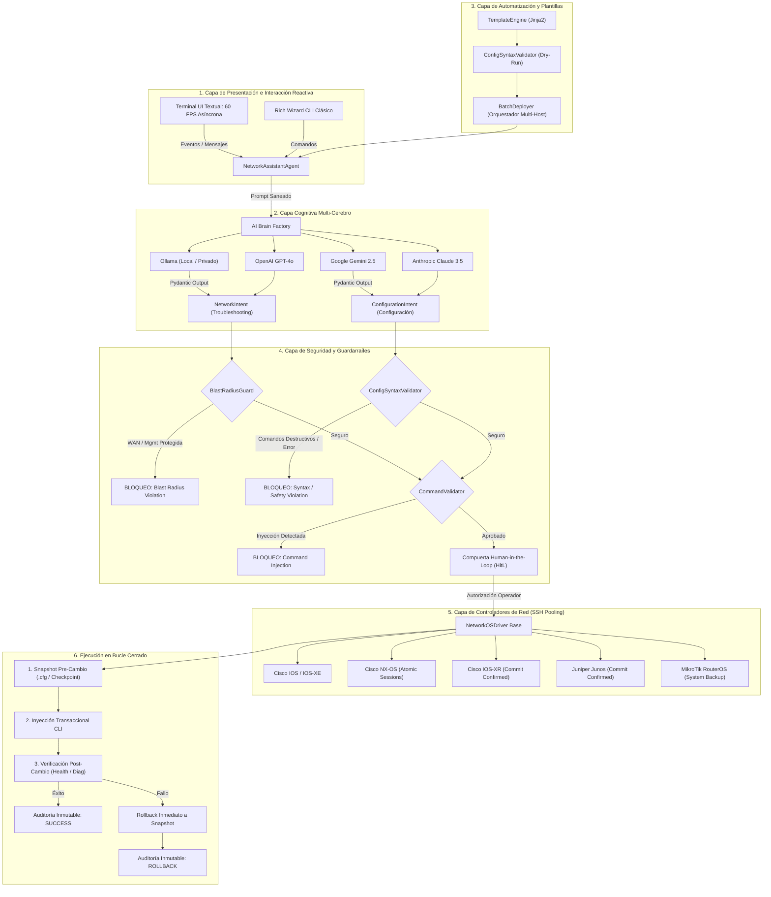
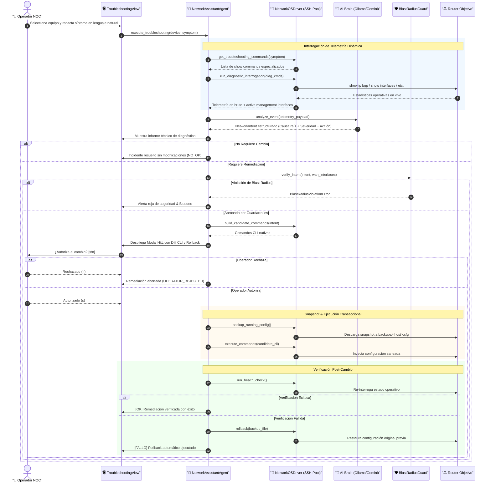
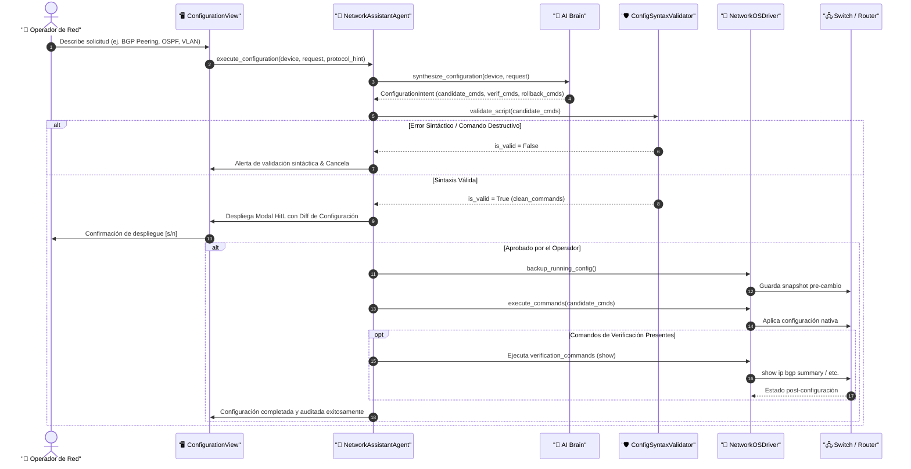
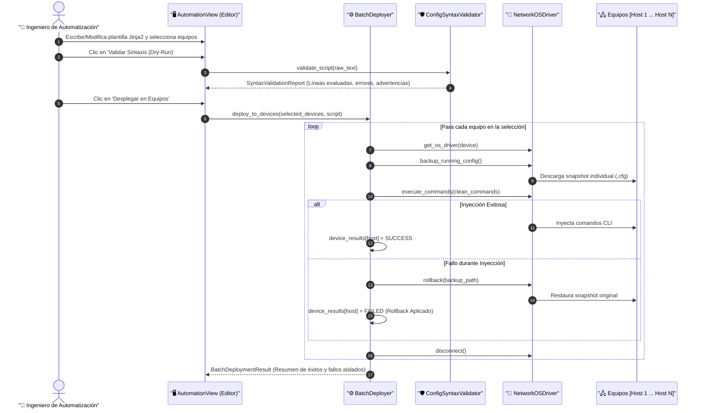

# 🏛️ Arquitectura del Sistema: NetworkingAgent Enterprise v2.0

> **Diseño Arquitectónico Hexagonal, Patrones de Ingeniería Closed-Loop y Garantías de Confiabilidad**

---

## 1. Visión General del Diseño

**NetworkingAgent Enterprise v2.0** está construido bajo el patrón de **Arquitectura Hexagonal (Puertos y Adaptadores)** combinado con automatización en **bucle cerrado (*Closed-Loop Automation*)**. 

El sistema desacopla de manera rigurosa tres responsabilidades fundamentales:
1. **Razonamiento Cognitivo:** Los Modelos de Lenguaje (LLMs) operan exclusivamente como motores de inferencia diagnóstica y síntesis lógica; **nunca** emiten comandos CLI directamente hacia los equipos sin pasar por esquemas tipados estritos (`NetworkIntent` o `ConfigurationIntent`).
2. **Defensa en Profundidad y Guardarraíles:** Ninguna instrucción generada por un operador o un modelo de IA alcanza el transporte SSH sin atravesar el análisis estático preventivo (`ConfigSyntaxValidator`), la validación de comandos prohibidos (`CommandValidator`) y la protección de interfaces de gestión y WAN (`BlastRadiusGuard`).
3. **Ejecución Transaccional Multi-Fabricante:** Los controladores de red (*drivers*) traducen intenciones lógicas a sintaxis nativa de fabricante, gestionan la reutilización de conexiones SSH (*Connection Pooling*), generan snapshots previos al cambio y garantizan la reversión atómica (*Rollback*) si la verificación operativa posterior detecta anomalías.

---

## 2. Capas del Sistema y Componentes

### 2.1. Capa de Presentación Reactiva (`src/networking_agent/tui/`)

La interfaz de usuario principal está construida con el framework reactivo **Textual**:

- **`app.py` (`NetworkingAgentApp`):** Controlador principal de la aplicación.
  - Orquesta el montaje y conmutación entre las 5 vistas de la plataforma sin recargas destructivas de pantalla.
  - Ejecuta operaciones de larga duración (SSH de Netmiko, consultas LLM, validación estática y despliegues en lote) en hilos de trabajo asíncronos en segundo plano utilizando el decorador `@work(thread=True)`, garantizando que la interfaz nunca se congele.
  - Proporciona insignias de telemetría dinámica en el encabezado (`BRAIN`, `EQUIPOS`, `HITL`) y escucha atajos globales (`1-5`, `h`, `s`, `d`, `r`, `q`).
- **Vistas Especializadas (`src/networking_agent/tui/widgets/`):**
  - `TroubleshootingView`: Diagnóstico por síntomas en lenguaje natural, selección de router y visualización del informe técnico de causa raíz.
  - `ConfigurationView`: Formulario declarativo para aprovisionamiento multi-protocolo, selector de categoría y visor de candidate CLI diff.
  - `AutomationView`: Editor de plantillas `TextArea` con números de línea, selector de templates Jinja2, botón de validación dry-run y selector múltiple de equipos (`SelectionList`).
  - `InventoryView`: Tabla de gestión de routers y switches con ejecución de pruebas de conectividad SSH en vivo.
  - `AuditView`: Visor en tiempo real de la bitácora inmutable JSONL.
- **Ventanas Modales Flotantes (`src/networking_agent/tui/modals/`):**
  - `AIOptionsModal`: Configuración adaptativa de proveedor y modelo LLM con enmascaramiento dinámico de contraseñas.
  - `DeviceModal`: Formulario de alta de dispositivos con validación de IP/Host y cifrado automático de credenciales.
  - `HitLApprovalModal`: Compuerta interactiva de confirmación humana con previsualización de comandos exactos a inyectar y detalles de rollback.

---

### 2.2. Capa Cognitiva Multi-Cerebro (`src/networking_agent/brains/`)

- **`base.py` (`LLMBrain`):** Interfaz abstracta que define los dos contratos de inferencia:
  1. `analyze_event(telemetry_data: str) -> NetworkIntent`: Diagnóstico de incidentes y selección de acción remediadora.
  2. `synthesize_configuration(device_host, vendor_family, natural_request, protocol_hint) -> ConfigurationIntent`: Síntesis declarativa de configuración multi-protocolo.
  - Protege las entradas no confiables mediante delimitadores XML `<telemetry_event>` y directivas en `HARDENED_SYSTEM_PROMPT` y `HARDENED_CONFIG_SYSTEM_PROMPT`.
- **`ollama.py`:** Conector local y soberano que interactúa con el endpoint HTTP de Ollama utilizando salidas estructuradas en formato JSON (`format="json"`).
- **`gemini.py`:** Conector oficial utilizando el nuevo SDK `google-genai` para invocar modelos `gemini-2.5-pro` y `gemini-2.5-flash` con forzado estricto de esquema Pydantic (`response_schema`).
- **`openai.py` / `anthropic.py`:** Adaptadores para OpenAI GPT-4o y Anthropic Claude 3.5 Sonnet.
- **`factory.py`:** Factoría dinámica que resuelve el proveedor configurado en tiempo de ejecución.

---

### 2.3. Capa de Modelos de Datos Tipados (`src/networking_agent/models/`)

- **`intent.py` (`NetworkIntent`):** Esquema Pydantic para el Pilar de Troubleshooting:
  - `diagnosis`: Resumen técnico de la causa raíz.
  - `severity`: Severidad (`LOW`, `MEDIUM`, `HIGH`, `CRITICAL`).
  - `requires_config_change`: Booleano estricto.
  - `action`: Catálogo cerrado de acciones remediadoras.
  - `target_interface`: Validador con expresiones regulares multi-vendor que rechaza caracteres shell y saltos de línea.
- **`config_intent.py` (`ConfigurationIntent`, `AutomationTemplate`, `BatchDeploymentResult`):** Esquema Pydantic para los Pilares de Configuración y Automatización:
  - `protocol_type`: Enumeración (`bgp`, `ospf`, `eigrp`, `stp`, `port_channel`, `vlan`, `acl`, `static_route`, `services`, `custom`).
  - `candidate_commands`: Lista de comandos CLI a inyectar, saneados contra metacaracteres shell (`;`, `&&`, `||`, `` ` ``).
  - `verification_commands`: Comandos de solo lectura para auditar el estado posterior.
  - `rollback_commands`: Comandos de negación atómica para reversión inmediata.

---

### 2.4. Capa de Automatización y Despliegue en Lote (`src/networking_agent/engine/automation.py`)

- **`TemplateEngine`:** Gestiona el catálogo de plantillas pre-cargadas (Hardening, VLAN/SVI, OSPF, NTP/Syslog, Junos IRB) y compila plantillas Jinja2 en modo estricto (`StrictUndefined`) para evitar variables indefinidas silenciosas.
- **`ConfigSyntaxValidator` (`src/networking_agent/guardrails/syntax_validator.py`):** Motor de análisis estático en seco (*Dry-Run*):
  - Evalúa línea por línea antes de abrir sockets SSH.
  - Bloquea comandos de reinicio (`reload`, `reboot`, `system reboot`).
  - Bloquea comandos destructivos de almacenamiento (`format flash:`, `erase startup-config`, `write erase`, `zeroize`, `reset-configuration`).
  - Detecta variables de plantilla sin renderizar (`{{...}}`).
  - Audita el balance de bloques jerárquicos en Junos (`{...}`).
  - Verifica prefijos requeridos en MikroTik RouterOS (`/` o `:`).
- **`BatchDeployer`:** Orquestador de despliegue sobre listas de dispositivos (`List[DeviceInventory]`):
  - Aplica validación estática previa.
  - Itera sobre cada equipo realizando un snapshot pre-cambio individual.
  - En caso de error en un equipo específico, ejecuta un rollback aislado sobre ese equipo sin abortar ni afectar a los dispositivos que completaron exitosamente.
  - Genera un reporte inmutable [`BatchDeploymentResult`](../src/networking_agent/models/config_intent.py).

---

### 2.5. Capa de Controladores de Red Multi-Fabricante (`src/networking_agent/drivers/`)

- **`base.py` (`NetworkOSDriver`):**
  - **SSH Connection Pooling:** Mantiene una sesión SSH activa a lo largo del flujo completo, eliminando handshakes repetitivos y reduciendo el tiempo de ejecución en más de un 80%.
  - **Dynamic Management Discovery (`discover_active_management_interfaces`):** Inspecciona salidas de telemetría en vivo para identificar qué puerto físico sostiene la IP de conexión SSH o la ruta por defecto (`0.0.0.0/0`), previniendo caídas accidentales.
  - **Protocol Diagnostic Commands:** Métodos especializados (`_bgp_diag_commands`, `_ospf_diag_commands`, `_vlan_diag_commands`, `_stp_diag_commands`, `_channel_diag_commands`, `_acl_diag_commands`) para interrogación en caliente.
  - **Snapshot y Rollback:** Generación de respaldos locales en `backups/<host>_<timestamp>.cfg` con prevención de *path traversal*.
- **Controladores Específicos:**
  - `cisco_ios.py`: Cisco IOS y IOS-XE con guardado persistente (`save_config`).
  - `cisco_nxos.py`: Cisco NX-OS con sesiones atómicas (`configure session`) y checkpoints de hardware nativos.
  - `cisco_xr.py`: Cisco IOS-XR con confirmación temporizada (`commit confirmed 180`).
  - `juniper.py`: Juniper Junos con reversión automática (`commit confirmed 3`).
  - `mikrotik.py`: MikroTik RouterOS v6/v7 con snapshots binarios (`/system backup save`).

---

## 3. Diagramas de Secuencia Operacionales

### 3.1. Secuencia: Troubleshooting Autónomo Closed-Loop

---

### 3.2. Secuencia: Configuración Declarativa Multi-Protocolo

---

### 3.3. Secuencia: Despliegue en Lote con `BatchDeployer`

