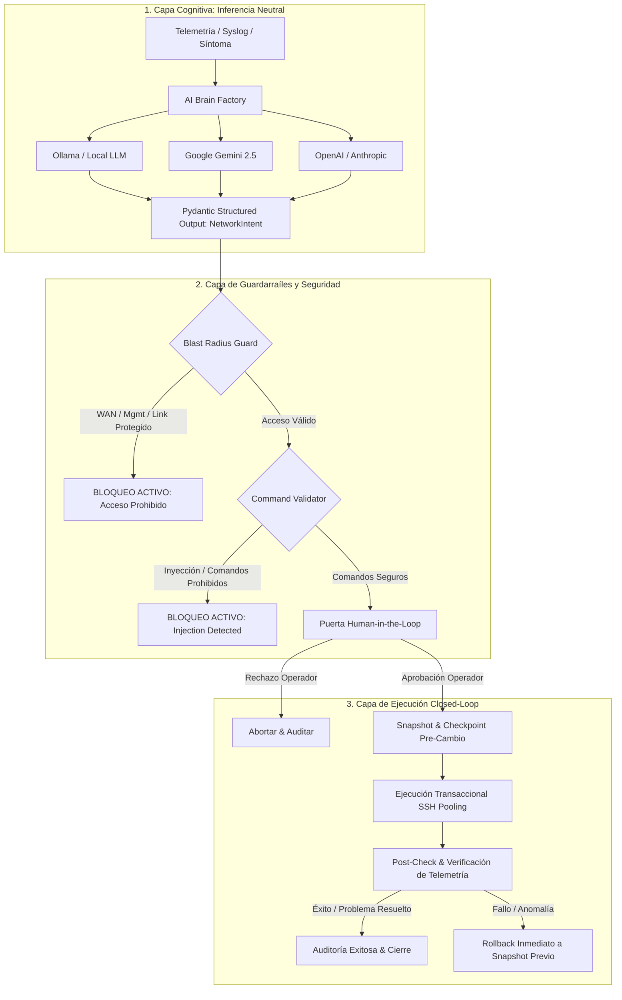

# 🏛️ Arquitectura del Sistema: NetworkingAgent Enterprise

> **Diseño Arquitectónico, Patrones de Ingeniería y Garantías de Confiabilidad**

---

## 1. Visión General del Diseño

**NetworkingAgent** implementa una arquitectura desacoplada basada en el patrón de **Puertos y Adaptadores (Arquitectura Hexagonal)** combinada con automatización en **bucle cerrado (*Closed-Loop Automation*)**.

El principio rector del sistema es **separar el razonamiento cognitivo de la ejecución técnica**:
- El Modelo de Lenguaje (LLM) **nunca** emite comandos CLI de bajo nivel directamente.
- El LLM solo analiza telemetría y produce una **intención neutral estructurada** (`NetworkIntent`).
- Los adaptadores técnicos (Drivers específicos de fabricante) traducen esa intención en comandos nativos probados y seguros.
- Múltiples capas de validación y control humano actúan como barreras infranqueables antes de que cualquier paquete SSH toque los equipos de red.



---

## 2. Capas del Sistema y Componentes

### 2.1. Capa de Ingesta y CLI (`src/networking_agent/cli/`)
- **`main.py`:** Punto de entrada para el usuario y despacho CLI. Gestiona el ciclo continuo de navegación entre diagnósticos sin salida prematura.
- **`interactive.py`:** Interfaz enriquecida con componentes [Rich](https://github.com/Textualize/rich), tablas dinámicas, paneles informativos y autodescubrimiento de modelos locales de Ollama y Gemini.
- **`prompts.py`:** Módulo de repregunta interactiva que ante entradas erróneas o involuntarias no cancela la sesión, sino que guía al operador para obtener la respuesta correcta.

### 2.2. Capa Cognitiva / Cerebros de IA (`src/networking_agent/brains/`)
- **`base.py`:** Define la clase abstracta `LLMBrain` y el `HARDENED_SYSTEM_PROMPT`. Aísla el contenido de telemetría dentro de delimitadores `<telemetry_event>` y neutraliza activamente cualquier intento de inyección de prompts o jailbreak.
- **`ollama.py`:** Conector nativo hacia Ollama (`netexpert:latest` o cualquier modelo local). Realiza inferencia local privada y estructurada sin enviar datos fuera de las instalaciones.
- **`gemini.py`:** Integración oficial con la API de Google GenAI (`google-genai`), soportando modelos de última generación con razonamiento estructurado (`gemini-2.5-pro`, `gemini-2.5-flash`).
- **`openai.py` / `anthropic.py`:** Proveedores de respaldo para OpenAI GPT-4o y Anthropic Claude 3.5 Sonnet.
- **`factory.py`:** Resuelve dinámicamente el proveedor activo configurado en SQLite o en el entorno.

### 2.3. Capa de Modelado Estricto (`src/networking_agent/models/`)
- **`intent.py` (`NetworkIntent`):** Esquema neutral forzado por Pydantic:
  - `diagnosis`: Diagnóstico de causa raíz (min 5, max 2000 caracteres).
  - `severity`: Nivel (`LOW`, `MEDIUM`, `HIGH`, `CRITICAL`).
  - `requires_config_change`: Booleano estricto.
  - `action`: Catálogo cerrado (`none`, `disable_interface`, `enable_interface`, `restart_interface`, `set_interface_mtu`, `set_interface_duplex_full`, `reset_bgp_neighbor`, `clear_arp_cache`).
  - `target_interface`: Validador con regex multi-fabricante (`GigabitEthernet`, `Ethernet`, `ge-`, `ether`, `sfp-sfpplus`). Rechaza caracteres de control, saltos de línea y metacaracteres shell. Coerción previa de valores vacíos o `none` a `None`.
  - `mtu_value`: Entero entre 68 y 9216.
  - `bgp_neighbor_ip`: Validador IP estándar (IPv4/IPv6).
- **`device.py` (`DeviceInventory`):** Encapsula credenciales de acceso. Valida `host` para evitar ataques de *Path Traversal* y enmascara contraseñas con `SecretStr`.
- **`telemetry.py` (`TelemetryEvent`):** Sanea payloads de log, purga bytes nulos (`\x00`) y limita la longitud a 30,000 caracteres para evitar ataques de denegación de servicio (DoS).

### 2.4. Capa de Seguridad y Guardarraíles (`src/networking_agent/guardrails/`)
- **`blast_radius.py` (`BlastRadiusGuard`):** Protege la infraestructura crítica contra cortes accidentales. Bloquea de forma incondicional cualquier intento de apagar o reiniciar interfaces WAN, uplinks, o interfaces de gestión remota identificadas en caliente.
- **`validator.py` (`CommandValidator`):** Escáner de seguridad previo a la conexión. Analiza la lista de comandos generados por los drivers y bloquea:
  - Formateo y borrado de almacenamiento de sistema.
  - Creación de cuentas de usuario administrativas o alteración de credenciales.
  - Descarga de archivos externos o binarios (`tool fetch`, `tftp-server`).
  - Proxies no autorizados (`ip socks`, `ip proxy`).
  - Encadenamiento shell (`&&`, `|`, `;`, `\`, `` ` ``, `$`).

### 2.5. Capa de Drivers de Fabricante (`src/networking_agent/drivers/`)
- **`base.py` (`NetworkOSDriver`):**
  - **Agrupación y Reutilización de Sesiones SSH (*SSH Connection Pooling*):** Mantiene una única conexión `ConnectHandler` activa a lo largo del diagnóstico, snapshot, ejecución y post-verificación, reduciendo la latencia de 15 segundos a menos de 2 segundos.
  - **Descubrimiento Dinámico de Interfaces de Gestión (`discover_active_management_interfaces`):** Analiza en tiempo real las salidas de telemetría para ubicar qué puerto físico aloja la IP del router o la ruta por defecto (`0.0.0.0/0`), garantizando que jamás se corte el acceso del operador.
- **Drivers Específicos:**
  - `cisco_ios.py`: Cisco IOS y IOS-XE.
  - `cisco_nxos.py`: Cisco NX-OS con sesiones transaccionales y checkpoints nativos.
  - `cisco_xr.py`: Cisco IOS-XR con `commit confirmed`.
  - `juniper.py`: Juniper Junos con `commit confirmed 3`.
  - `mikrotik.py`: MikroTik RouterOS v6 y v7 con `/system backup` e `/interface set`.

### 2.6. Capa de Bóveda y Persistencia (`src/networking_agent/core/`)
- **`db.py` (`DatabaseManager`):** Motor SQLite optimizado con `PRAGMA journal_mode = WAL;`, `synchronous = NORMAL` y tablas en memoria. Almacena configuraciones y el inventario de equipos.
- **`crypto.py` (`SecretVault`):** Cifrado simétrico Fernet (AES-128-CBC) para claves y contraseñas. Restringe permisos en el sistema de archivos a solo lectura/escritura del propietario (`0600`).
- **`audit.py` (`AuditLogger`):** Registro inmutable en formato JSONL (`logs/audit.jsonl`).

---

## 3. Diagrama de Secuencia: Flujo Closed-Loop Completo

```mermaid
sequenceDiagram
    autonumber
    actor Operador as 👤 Ingeniero de Red
    participant CLI as 🖥️ CLI Interactivo
    participant Agent as 🤖 NetworkAssistantAgent
    participant Brain as 🧠 Cerebro de IA (Ollama/Gemini)
    participant Guard as 🛡️ BlastRadius & Validator
    participant Driver as 🔌 NetworkOSDriver (SSH Pooling)
    participant Device as 🖧 Router / Switch Físico

    Operador->>CLI: Ingresa síntoma u opera evento de telemetría
    CLI->>Agent: process_telemetry(device, telemetry, mode="PROACTIVE")
    
    rect rgb(240, 248, 255)
        Note over Agent,Driver: Diagnóstico en Vivo (Reutilizando SSH)
        Agent->>Driver: get_connection() -> SSH Socket activo
        Driver->>Device: Ejecuta health_check (CPU, interfaces, errores)
        Device-->>Driver: Retorna estadísticas operativas
        Driver-->>Agent: health_data + discovery de interfaces WAN
    end

    Agent->>Brain: analyze_event(payload saneado)
    Brain-->>Agent: NetworkIntent estructurado (Causa raíz + Acción)

    Agent->>CLI: Muestra tabla de diagnóstico técnico

    alt No requiere cambios en equipo
        Agent->>CLI: Muestra informe operacional & Registra NO_OP
    else Requiere modificación de configuración
        Agent->>Guard: verify_intent(intent, wan_interfaces)
        alt Viola Blast Radius o Comandos Prohibidos
            Guard-->>Agent: BlastRadiusViolationError / CommandInjectionError
            Agent->>CLI: Muestra alerta roja de seguridad & Bloquea ejecución
        else Aprobado por Guardarraíles
            Agent->>Driver: build_candidate_commands(intent)
            Driver-->>Agent: candidate_cli nativo
            Agent->>CLI: Muestra Solicitud de Aprobación HitL con Diff CLI
            CLI->>Operador: ¿Autoriza ejecución? (s/n)
            
            alt Operador Rechaza
                Operador-->>CLI: Rechazado ('n')
                CLI->>Agent: approved = False
                Agent->>CLI: Dispositivo intacto & Registra OPERATOR_REJECTED
            else Operador Autoriza
                Operador-->>CLI: Autorizado ('s')
                CLI->>Agent: approved = True
                
                rect rgb(255, 250, 240)
                    Note over Agent,Device: Snapshot & Ejecución Transaccional
                    Agent->>Driver: backup_running_config()
                    Driver->>Device: Descarga snapshot / genera checkpoint local
                    Agent->>Driver: execute_commands(candidate_cli)
                    Driver->>Device: Inyecta configuración transaccional
                end

                rect rgb(240, 255, 240)
                    Note over Agent,Device: Post-Verificación & Rollback
                    Agent->>Driver: run_health_check()
                    Driver->>Device: Re-interroga estado operativo posterior
                    Agent->>Agent: evaluate_changes(pre_health, post_health)
                    
                    alt Verificación Exitosa
                        Agent->>CLI: [OK] Remediación verificada con éxito
                        Agent->>Agent: AuditLogger -> REMEDIATION_SUCCESS
                    else Verificación Fallida
                        Agent->>Driver: rollback(backup_path)
                        Driver->>Device: Restaura configuración original previa
                        Agent->>CLI: [FALLO] Rollback automático ejecutado
                        Agent->>Agent: AuditLogger -> REMEDIATION_ROLLBACK
                    end
                end
            end
        end
    end

    Note over Agent,Driver: Cierre Seguro de Sesión
    Agent->>Driver: driver.disconnect() -> Cierra socket SSH
