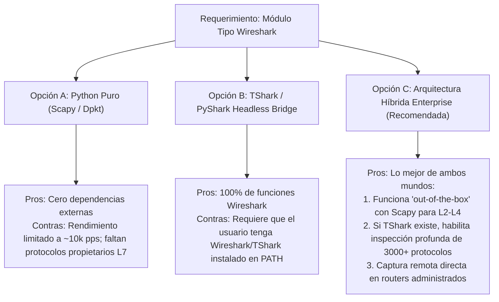

# 📡 Estudio de Viabilidad y Plan Arquitectónico: Módulo de Captura y Análisis de Paquetes (Tipo Wireshark) para NetworkingAgent Enterprise

**Documento de Arquitectura y Análisis de Factibilidad Técnica**  
**Versión de Destino Propuesta:** v2.2.0 – v2.3.0  
**Clasificación:** Propuesta Técnica de I+D (Research & Architecture RFC)  
**Fecha:** 8 de Noviembre de 2026  

---

## 1. Resumen Ejecutivo y Veredicto de Factibilidad

### 1.1. La Pregunta Fundamental
> *¿Es técnica y operativamente factible incorporar en NetworkingAgent Enterprise un módulo equivalente a Wireshark con todas sus capacidades de captura, disección profunda e inspección de paquetes?*

### 1.2. Veredicto Técnico: **FACTIBLE (Modelo Híbrido Orientado a Redes)**  
* **Factible al 100% mediante una Arquitectura Híbrida Inteligente:** Integrar captura local, ingesta de capturas remotas en routers de red (**Embedded Packet Capture / EPC**), motor de disección multi-nivel (TShark/Scapy) y una interfaz de terminal TUI reactiva en 3 paneles (equivalente a *Termshark*), potenciada por el motor de IA de NetworkingAgent.
* **Inviable si se pretende reescribir desde cero en Python:** Wireshark posee más de **3,000 disectores de protocolo** desarrollados en C/C++ durante más de 25 años (~3.5 millones de líneas de código). Intentar replicar la totalidad de disectores en Python puro penalizaría drásticamente el rendimiento de la CPU en flujos gigabit y representaría un esfuerzo titánico innecesario.

```
+-----------------------------------------------------------------------------------------+
|                  ARQUITECTURA RECOMENDADA: "NETWORKINGAGENT PACKET LAB"                  |
+-----------------------------------------------------------------------------------------+
|  [ Fuentes de Captura ]                                                                |
|    ├── Local NIC (Npcap / libpcap en Windows / Linux)                                  |
|    └── Remote Network Devices (Cisco EPC, Juniper monitor traffic, MikroTik sniffer)   |
+-----------------------------------------------------------------------------------------+
|  [ Motor de Disección y Filtrado (Cores) ]                                             |
|    ├── Core Ligero (Scapy / dpkt): Disección en tiempo real L2-L4 sin dependencias     |
|    └── Core Profundo (TShark Engine): Disección L7 de 3,000+ protocolos y sintaxis BPF |
+-----------------------------------------------------------------------------------------+
|  [ Interfaz TUI Reactiva (Textual) ]                                                   |
|    ├── Panel 1: Lista de Tramas (No, Tiempo, Origen, Destino, Protocolo, Info)         |
|    ├── Panel 2: Árbol Jerárquico de Protocolo (Ethernet -> IPv4 -> TCP -> HTTP)        |
|    ├── Panel 3: Volcado Hexadecimal (Hex Dump & ASCII Inspector)                       |
|    └── Barra Superior: Filtro en vivo (Sintaxis BPF / Display Filters)                  |
+-----------------------------------------------------------------------------------------+
|  [ Capa Diferenciadora: "AI Packet Doctor" ]                                           |
|    └── Diagnóstico autónomo: Detección de TCP Retransmits, Zero-Window, BGP Flaps,     |
|        análisis de handshake TLS y sugerencias automáticas de remediación de red.      |
+-----------------------------------------------------------------------------------------+
```

---

## 2. Deconstrucción de Wireshark vs. Necesidades del Agente

Para diseñar un módulo viable, debemos desglosar los cuatro pilares fundamentales de Wireshark:

| Pilar de Wireshark | Enfoque Wireshark Tradicional | Enfoque Propuesto para NetworkingAgent | Viabilidad |
| :--- | :--- | :--- | :---: |
| **1. Captura de Tráfico (Capture Engine)** | Drivers de bajo nivel (`Npcap` en Windows, `libpcap` en Linux) en modo promiscuo. | **Dual:** Soporte para captura en tarjeta local + **Captura Remota Transaccional (EPC)** en routers Cisco, Juniper y MikroTik vía SSH. | **ALTA** |
| **2. Disección de Protocolos (Dissectors)** | Librería C `libwireshark` con 3,000+ protocolos y reensamblaje de flujos TCP. | Disección nativa L2–L4 en Python (Scapy) + Enlace headless con `tshark -T json` para protocolos complejos L7. | **ALTA** |
| **3. Motor de Filtrado (Display Filters)** | Lenguaje dfilter (`ip.addr == 10.1.1.1 && tcp.port == 443`). | Compilación de expresiones BPF para captura previa + Filtros de visualización dfilter / regex. | **ALTA** |
| **4. Interfaz Gráfica (GUI)** | Interfaz de escritorio pesada en Qt6. | **TUI Cyberpunk Reactiva (Textual):** 3 paneles interactivos en terminal, soporte de ratón y paleta de comandos. | **ALTA** |

---

## 3. Comparativa de Estrategias de Implementación



### 3.1. Opción A: Python Puro con Scapy (`scapy.all.sniff`)
* **Ventajas:** Completamente autocontenido en el binario `.exe` de NetworkingAgent; no requiere software de terceros.
* **Limitaciones:** En flujos superiores a 50 Mbps o 15,000 paquetes por segundo, el recolector de basura de Python y la deserialización de objetos saturan un hilo de CPU. Solo soporta cientos de protocolos (no miles).

### 3.2. Opción B: TShark Headless Bridge (`pyshark` / subprocess)
* **Ventajas:** Obtiene el 100% exacto de los disectores de Wireshark, estadísticas de flujo, reensamblaje TCP, exportación a `.pcapng` y análisis forense idéntico a Wireshark.
* **Limitaciones:** Requiere que el equipo host tenga instalado Wireshark / TShark.

### 3.3. Opción C (Recomendada): Modelo Híbrido Adaptativo con Captura Remota
1. **Modo Autónomo / Standalone:** Utiliza Scapy/dpkt integrado en el `.exe` para capturas locales rápidas (DNS, DHCP, ICMP, TCP Handshakes, OSPF Hello, BGP Keepalive).
2. **Modo Enterprise / Deep Inspection:** Si el sistema detecta `tshark` en el `PATH` o configurado en el agente, activa automáticamente la potencia completa de Wireshark.
3. **Captura Remota Integrada en Equipos (EPC):** El agente le ordena al router Cisco (`monitor capture`), Juniper (`monitor traffic`) o MikroTik capturar paquetes en la interfaz WAN/LAN, los descarga cifrados vía SFTP/SCP y los abre de inmediato en el visor TUI.

---

## 4. Diseño del Módulo TUI: "Packet Lab" (Visor en 3 Paneles)

Inspirado en la ergonomía de *Termshark*, pero estilizado con la identidad visual dark/light y colores de consola de NetworkingAgent:

```
+----------------------------------------------------------------------------------------------------+
| PACKET LAB: eth0 [CAPTURA ACTIVA - 1,420 pkts] [Filtro: ip.proto == 6 && tcp.flags.syn == 1]       |
+-----+--------------+-----------------+-----------------+----------+--------+-----------------------+
| No. | Tiempo (s)   | Origen          | Destino         | Proto    | Long.  | Info Resumen          |
+-----+--------------+-----------------+-----------------+----------+--------+-----------------------+
|   1 | 0.000000     | 192.168.1.15    | 10.10.10.1      | TCP      | 74     | 54322 -> 80 [SYN]     |
|   2 | 0.001420     | 10.10.10.1      | 192.168.1.15    | TCP      | 74     | 80 -> 54322 [SYN, ACK]|
|   3 | 0.001510     | 192.168.1.15    | 10.10.10.1      | TCP      | 66     | 54322 -> 80 [ACK]     |
|   4 | 0.012300     | 192.168.1.15    | 10.10.10.1      | HTTP     | 245    | GET /api/v1/health    |
+-----+--------------+-----------------+-----------------+----------+--------+-----------------------+
| [-] Frame 4: 245 bytes on wire, 245 bytes captured                                                 |
| [-] Ethernet II, Src: 00:0c:29:ab:cd:ef, Dst: 00:50:56:12:34:56                                     |
| [-] Internet Protocol Version 4, Src: 192.168.1.15, Dst: 10.10.10.1                                |
| [-] Transmission Control Protocol, Src Port: 54322, Dst Port: 80, Seq: 1, Ack: 1                   |
| [-] Hypertext Transfer Protocol                                                                    |
|     Expert Info: [Note] Response in frame 5                                                       |
+----------------------------------------------------------------------------------------------------+
| 0000  00 50 56 12 34 56 00 0c 29 ab cd ef 08 00 45 00  .PV.4V..).....E.                          |
| 0010  00 e7 1a 2b 40 00 40 06 b2 c1 c0 a8 01 0f 0a 0a  ...+@.@.........                          |
| 0020  0a 01 d4 32 00 50 00 00 00 01 00 00 00 01 80 18  ...2.P..........                          |
+----------------------------------------------------------------------------------------------------+
| [p] Pausar | [s] Guardar .pcap | [f] Filtrar | [a] Diagnóstico IA | [r] Volver | Tab: Cambiar Panel    |
+----------------------------------------------------------------------------------------------------+
```

### Funciones Interactivas en la TUI:
1. **Navegación con flechas / Ratón:** Selección fluida de paquetes en el Panel 1; el Panel 2 y 3 se actualizan en milisegundos de forma asíncrona.
2. **Colapsado/Expandido jerárquico:** Presionar `Enter` o hacer clic en `[-] / [+]` en el panel de disección despliega o contrae campos de cabecera.
3. **Hex Dump sincronizado:** Al seleccionar un campo en el árbol de protocolos (ej. dirección IP destino), el volcado hexadecimal resalta en cyan los bytes correspondientes.
4. **Exportación e Importación:** Carga y guardado nativo en formato universal `.pcap` y `.pcapng`.

---

## 5. El Valor Diferenciador: "AI Packet Doctor"

Wireshark estándar solo muestra datos brutos y requiere que el ingeniero sea un experto en interpretar secuencias TCP y banderas hexadecimales. NetworkingAgent puede revolucionar esto incorporando **análisis contextual autónomo**:

```mermaid
sequenceDiagram
    autonumber
    actor Ing as Ingeniero de Redes
    participant TUI as TUI Packet Lab
    participant Sniff as Sniffer Engine
    participant AI as AI Packet Doctor (LLM)
    participant Dev as Router Remoto (Cisco/Junos)

    Ing->>TUI: Solicita: "Diagnosticar pérdida de paquetes en WAN hacia 10.0.0.1"
    TUI->>Dev: Dispara Embedded Packet Capture (ACL dirigida)
    Dev-->>Sniff: Transfiere buffer PCAP (100 tramas)
    Sniff->>AI: Entrega resumen estadístico + anomalías de tramas
    AI->>AI: Detecta TCP Retransmissions (15%) + ICMP Type 3 Code 4 (MTU mismatch)
    AI-->>TUI: Presenta informe de diagnóstico con causa raíz y comando de solución
    TUI-->>Ing: Muestra dictamen: "MTU de 1500 bloqueada; se requiere 'ip mtu 1492' o MSS Clamping"
```

### Capacidades del "AI Packet Doctor":
1. **Detección de Caídas de Rendimiento TCP:**
   - Detección automática de *TCP Out-of-Order*, *Dup ACKs*, *Fast Retransmissions* y *TCP Window Full / Zero Window*.
2. **Diagnóstico de Protocolos de Enrutamiento:**
   - Análisis de mensajes OSPF/BGP: ¿Por qué no pasa de *ExStart* a *Full*? (Mismatched MTU o Network Type).
3. **Análisis de Fallos de Seguridad y Negociación:**
   - Alertas por *RST Injection*, handshake TLS fallido por discrepancia de Ciphersuite o expiración de certificado.

---

## 6. Consideraciones de Rendimiento y Despliegue en Windows / Linux

| Desafío Técnico | Impacto | Estrategia de Solución Técnica |
| :--- | :--- | :--- |
| **Driver de Captura en Windows** | En Windows, capturar tráfico crudo de la NIC requiere driver de kernel (Npcap). | 1. Si no hay Npcap, el agente ofrece el modo **Captura Remota en Routers** (que no necesita drivers locales).<br>2. Proporcionar un instalador silencioso opcional de Npcap OEM o recomendar su activación. |
| **Consumo de Memoria en Capturas Largas** | Guardar millones de paquetes en RAM satura la memoria del proceso. | Utilizar una base de datos temporal en disco basada en SQLite (modo WAL) o buffer circular (*Ring Buffer*) limitado a 10,000 tramas en visualización activa. |
| **Rendimiento de Hilos de la TUI** | El procesamiento de paquetes no debe bloquear la interfaz visual Textual (60 FPS). | Desacoplamiento total: El sniffer corre en un subproceso/hilo dedicado (*Worker Thread*) y envía únicamente eventos enriquecidos a la TUI mediante colas asíncronas (`asyncio.Queue`). |

---

## 7. Hoja de Ruta Propuesta (Roadmap de Implementación)

### Fase 1: Motor Base y Visor PCAP (v2.2.0)
* Creación de la estructura del módulo `src/networking_agent/sniffer/`.
* Lector y parser de archivos `.pcap` / `.pcapng` locales usando `dpkt` o `scapy`.
* Implementación de la vista TUI en 3 paneles interactivos (`PacketLabView`).
* Filtros rápidos por protocolo (TCP, UDP, ICMP, DNS, ARP).

### Fase 2: Captura en Vivo Local y Remota (v2.2.1)
* Integración del sniffer en vivo local para Windows y Linux (`scapy.all.AsyncSniffer`).
* Conector de captura remota en equipos de red (**Cisco EPC**, **MikroTik Packet Sniffer**).
* Guardado directo a archivo `.pcap`.

### Fase 3: Integración Profunda con TShark (Opcional/Auto-detectada) (v2.3.0)
* Detección de binario `tshark` en el sistema para habilitar disección L7 profunda.
* Integración de sintaxis completa de *Wireshark Display Filters*.

### Fase 4: Inteligencia de Paquetes con IA ("AI Packet Doctor") (v2.3.1)
* Analizador de causa raíz sobre trazas de paquetes.
* Botón de diagnóstico instantáneo `[a]` en la TUI: el modelo LLM analiza la captura seleccionada y genera un informe de remediación en segundos.

---

## 8. Conclusión y Recomendación

Integrar un módulo similar a Wireshark **es completamente viable y posicionaría a NetworkingAgent Enterprise en una categoría superior de mercado**, siempre y cuando se adopte la **Arquitectura Híbrida Inteligente**:

1. **No intentar reescribir 3,000 disectores en Python:** Aprovechar Scapy para el 90% de los incidentes habituales y delegar en TShark para disección exhaustiva.
2. **Priorizar la Captura Remota en Routers (EPC):** Para un ingeniero de redes, capturar tráfico directamente en un router Cisco, Juniper o MikroTik desde la consola del agente es infinitamente más valioso que una simple captura en su tarjeta de red local.
3. **El factor decisivo es la Inteligencia Artificial:** Un "Wireshark con IA" que no solo capture paquetes, sino que le explique al ingeniero en lenguaje claro qué está fallando en su red y cómo solucionarlo, convertirá a NetworkingAgent en una herramienta imprescindible en cualquier Centro de Operaciones de Red (NOC).
